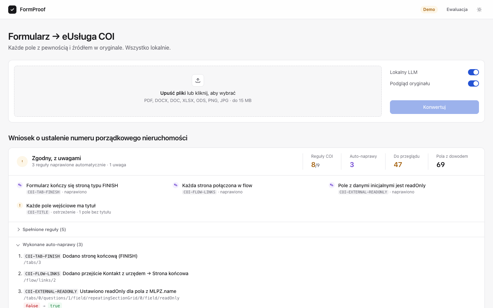

# FormProof – formularz urzędowy → JSON e-usługi COI, z dowodem dla każdego pola

FormProof zamienia plik formularza (PDF, DOC/DOCX, ODS, XLSX, skan JPG/JPEG/PNG) w konfigurację formularza
e-usługi zgodną ze schemą COI (`importowanyPlikJsonSchemat`). Działa w całości lokalnie: parsery, OCR (Tesseract)
i opcjonalnie lokalny model open-weights (Ollama). Żadnych usług SaaS ani zewnętrznych API LLM.

**Element innowacyjny – Dowód i zaufanie.** Jako jedyni dajemy JSON z dowodem: każde pole ma `confidence`
i odniesienie do fragmentu oryginału (strona, bbox, tekst). Wbudowany walidator 29 reguł technicznych COI
z auto-naprawą kieruje urzędnika tylko do pól niepewnych, więc cyfryzacja trwa minuty, nie godziny.

- `form` – czysty JSON wg schemy COI (bez dodatkowych kluczy), gotowy do importu.
- `report` – osobno: pewność i źródło każdego pola, lista „Do przeglądu”, wynik reguł COI, wykonane naprawy,
  propozycje nowych słowników, czasy etapów, informacja o użyciu LLM.



**Co działa:**

- 8 rozszerzeń wejścia wg zadania (PDF, DOC, DOCX, ODS, XLSX, JPG, JPEG, PNG – obrazy przez OCR), także kilka plików naraz.
- Sekcje, pola, typy, walidatory, REQUIRED, słowniki (Kraje, Numery kierunkowe, Województwo, adres TERYT), stany SHOW.
- Plik z kilkoma wnioskami (spis „Rodzaje wniosków”) → pole wyboru rodzaju wniosku, sekcje wariantów pokazywane warunkowo,
  wspólne sekcje raz.
- Pętla urzędnika: edycja pola w UI → ponowna walidacja (`/forms/validate`), walidatory sprawdzane na żywo w podglądzie.
- Strona „Wyniki ewaluacji” (`/eval.html`): metryki względem wzorcowego JSON formularza 1.

## Szybki start

```bash
cp .env.example .env              # opcjonalne (bez .env działają wartości domyślne trybu demo)
docker compose up --build         # api :8000 + ollama
docker compose exec ollama ollama pull qwen3.5:4b   # jednorazowo (opcjonalne; bez modelu działa tryb reguł)
```

UI: http://localhost:8000/ (bez logowania). OpenAPI: http://localhost:8000/docs.

Na Macu Ollama w Dockerze nie ma GPU – szybciej z Ollamą na hoście: `OLLAMA_URL=http://host.docker.internal:11434`.

Lokalnie bez Dockera (Python 3.14 + [uv](https://docs.astral.sh/uv/), Tesseract z językiem `pol`):

```bash
uv sync
uv run python -m formproof        # :8000
```

## Uwierzytelnianie (opcjonalne)

To wersja demonstracyjna, więc API jest domyślnie otwarte: UI i `curl` działają bez tokenu.
Wdrożenie z JWT (HS256) włączasz zmienną `AUTH_ENABLED=true`; `APP_ENV=production` bez niej się nie uruchomi. Wtedy wszystkie endpointy poza `/health` i `/auth/token`
wymagają `Authorization: Bearer`, a przy `APP_ENV=production` aplikacja odmówi startu bez własnych
`JWT_SECRET` (≥ 32 znaki) i `AUTH_CLIENT_SECRET` oraz z `DEMO_UI=true`. Konto klienta: `AUTH_CLIENT_ID` / `AUTH_CLIENT_SECRET`
(domyślnie `demo` / `demo-secret`, tylko dev).

## REST API (prefiks `/api/v1`)

| Metoda | Ścieżka | Opis |
|---|---|---|
| POST | `/auth/token` | tylko z `AUTH_ENABLED=true`: `{clientId, clientSecret}` → `{accessToken, expiresIn}` |
| POST | `/forms/convert?llm=true&previews=false` | multipart `file` → `{form, report}` |
| POST | `/forms/convert/batch` | multipart wiele `file` → `{results: [{filename, ok, form?, report?, error?}]}` |
| POST | `/forms/validate?repair=true` | body: JSON formularza → `{form, rules, repairs}` (form po naprawie) |
| GET | `/dictionaries`, `/dictionaries/{name}` | słowniki (Kraje, Numery kierunkowe, Województwo, …) |
| GET | `/health` | bez JWT |

```bash
curl -s localhost:8000/api/v1/forms/convert \
  -F 'file=@Wniosek o zwrot opłaty skarbowej.pdf' | jq '.report.rules | length'
```

Błędy: `400` (`NO_FILE`, `BAD_FILENAME`, `EMPTY`, `TOO_MANY_FILES`, `INVALID_REQUEST`), `401` (`UNAUTHORIZED`),
`413` (`FILE_TOO_LARGE`), `415` (`BAD_EXTENSION`, `MIME_MISMATCH`), `422` (`NOTHING_EXTRACTED`, `INVALID_FORM`),
`504` (`TIMEOUT`). Format: `{code, message}`.

Walidacja pliku:

- rozszerzenie: `pdf`, `doc`, `docx`, `ods`, `xlsx`, `jpg`, `jpeg`, `png`;
- nazwa ≤ 250 znaków, bez `; : > < / \ | ' * % $` (oraz znaków sterujących, `"`, `?`, `..`);
- typ MIME: deklarowany `Content-Type` musi pasować do rozszerzenia (dopuszczalny ogólny `application/octet-stream`),
  a zawartość jest sprawdzana po sygnaturze bajtów i strukturze (OOXML/ODF w ZIP, strumień `WordDocument` w OLE dla DOC);
- rozmiar: `MAX_FILE_BYTES` na plik, `MAX_BATCH_BYTES` na całe żądanie batch – sprawdzane po `Content-Length`
  i w trakcie odbioru, zanim plik trafi do parsera;
- plik żyje tylko w pamięci (i w `tmpfs` kontenera) na czas żądania, nic nie jest zapisywane.

## Konfiguracja (`.env`)

`APP_ENV`, `PORT`, `AUTH_ENABLED`, `JWT_SECRET`, `JWT_EXPIRES_S`, `JWT_ISSUER`, `JWT_AUDIENCE`, `AUTH_CLIENT_ID`, `AUTH_CLIENT_SECRET`,
`MAX_FILE_BYTES`, `MAX_BATCH_FILES`, `MAX_BATCH_BYTES`, `MAX_OCR_PAGES`, `REQUEST_TIMEOUT_S`, `LLM_ENABLED`, `OLLAMA_URL`, `LLM_MODEL`,
`LLM_TIMEOUT_S`, `TESSERACT_CMD`, `DEMO_UI`. Opis i wartości domyślne: `.env.example`.

## Cena i koszt rozwiązania

Rozwiązanie działa w całości lokalnie, więc nie ma opłat za licencje, API ani chmurę. Zmierzone na MacBooku Air z Apple M4 (24 GB RAM).

| Pozycja | Wartość |
|---|---|
| Licencje (kod, zależności, model) | **0 zł**: MIT/BSD/Apache/MPL, model Qwen 3.5 4B open-weights |
| Opłaty za API LLM / SaaS | **0 zł**, brak takich wywołań w runtime |
| Sprzęt do uruchomienia | jeden MacBook Air M4 albo zwykły serwer x86 (4 rdzenie, 8 GB RAM bez LLM, 16 GB z LLM) |
| Rozmiar obrazu Docker (API) | ok. 350 MB; model Ollama ok. 4 GB (opcjonalny) |
| Czas konwersji jednego pliku | tryb reguł: ok. 0,3–8 s (skany dłużej); z lokalnym LLM: ok. 9–16 s |
| Energia na 1000 formularzy | ok. 0,06 kWh przy 15 W i 15 s na plik, czyli poniżej 1 zł |

**Szacunek oszczędności (założenia do zmiany pod własną organizację).** Ręczna analiza i przepisanie jednego formularza
zajmuje analitykowi ok. 2 h (COI opisuje ten proces jako czasochłonny i kosztowny). Przy wersji roboczej od FormProof urzędnik
sprawdza tylko pola z listy „Do przeglądu”, załóżmy ok. 20 min. Przy stawce 100 zł/h:

| | Ręcznie | Z FormProof |
|---|---|---|
| Koszt pracy na formularz | 200 zł | ok. 33 zł |
| 500 formularzy | 100 000 zł | ok. 16 500 zł + sprzęt |

Oszczędność ok. 80% czasu pracy, a całkowity koszt wdrożenia to sprzęt (np. jeden MacBook Air M4, cena rynkowa ok. 5–6 tys. zł)
i godziny administratora. Liczby czasu pochodzą z pomiarów (`scripts/eval/run.py`), liczby kosztu pracy to założenia.

## Architektura

Pełny opis: [docs/ARCHITECTURE.md](docs/ARCHITECTURE.md).

```
plik → ingest (rozszerzenie, MIME, nazwa, rozmiar)
     → extract (pdfplumber / OCR Tesseract / python-docx / openpyxl / ODS xml / DOC olefile) → SourceDoc (bloki + bbox)
     → infer (układ + katalog pojęć: sekcje, pola, typy, walidatory, REQUIRED, zależności) → DraftForm z confidence
     → llm (opcjonalnie: lokalny model doprecyzowuje niepewne pola; timeout, cache, fallback do reguł)
     → dictionaries (słowniki, dane inicjalne MLPZ/EXTERNAL_SYSTEM, propozycje nowych słowników)
     → build (UUID, techName, siatka, strony MAIN/FINISH, flow, stany SHOW w JSONata)
     → validate (schema + 29 reguł COI + auto-naprawa) → {form, report}
```

Każdy krok to czysta funkcja z kontraktem w `src/formproof/types/`. Brak bazy danych – usługa bezstanowa.
Zero reguł pisanych pod konkretne pliki: heurystyki działają na układzie i treści etykiet.

## Jakość i licencje

```bash
uv run pytest                     # testy jednostkowe + e2e API na materiałach (jeśli dostępne)
uv run python scripts/eval/run.py # metryki vs wzorcowy JSON formularza 1
uv run python scripts/license_check.py   # blokuje zależności copyleft (GPL/AGPL)
```

Obraz: `python:3.14.10-alpine3.24`, użytkownik `app`, system plików tylko do odczytu. Zależności tylko na licencjach
MIT/BSD/Apache/MPL.

## Ograniczenia (uczciwie)

- Słowniki Powiat/Gmina/Miejscowość: w JSON-ie pola dostają `dictionaryName` (dane dostarcza platforma COI); lokalnie dołączona jest tylko próbka. Kraje, Numery kierunkowe, Województwo – pełne.
- DOC (binarny Word) – tylko tekst, bez układu.
- **OCR (JPG/PNG/skany PDF) wymaga poprawy – nie zdążyliśmy w trakcie hackathonu.** Tekst czytany jest
  poprawnie, ale układ tabel jest słaby: Tesseract skleja komórki jednego wiersza, ramki tabel dają śmieci
  („BB”, „|”), wykropkowania bywają czytane jako litery, a linie do wpisania poza tabelą giną (brak pól).
  Plan: wykrywanie linii tabeli i wykropkowań na obrazie, wymazanie ich przed OCR, podział tekstu na komórki
  i kolejność wg wierszy tabeli. Do tego czasu pola z OCR mają niższe `confidence` i trafiają do przeglądu;
  najlepsze wyniki dają PDF z warstwą tekstu, DOCX, ODS i XLSX.
- Deklaracje z numerowanymi pozycjami (np. deklaracja śmieciowa) obsługuje osobny tryb pozycji; dla DOC
  (binarny Word, bez układu) wynik jest wyraźnie słabszy.
- Pliki z kilkoma wnioskami: sąsiednie identyczne bloki (np. kilku podopiecznych) scalamy w `REPEATING_SECTION`;
  nietypowe bloki wnioskodawcy rozpoznawane słabiej.
- Wynik to propozycja do przeglądu przez urzędnika, nie ostateczna decyzja.

Licencja: MIT.
